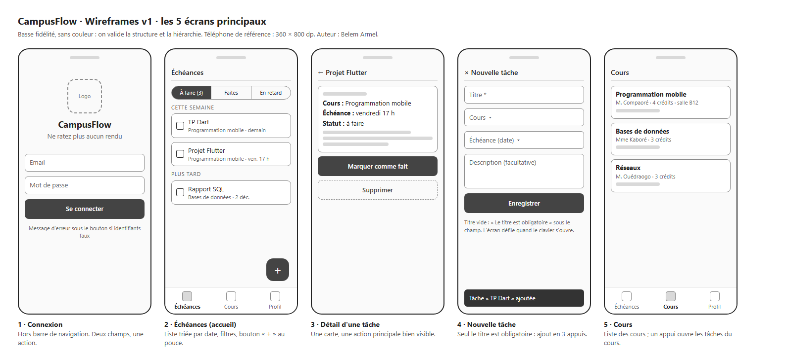
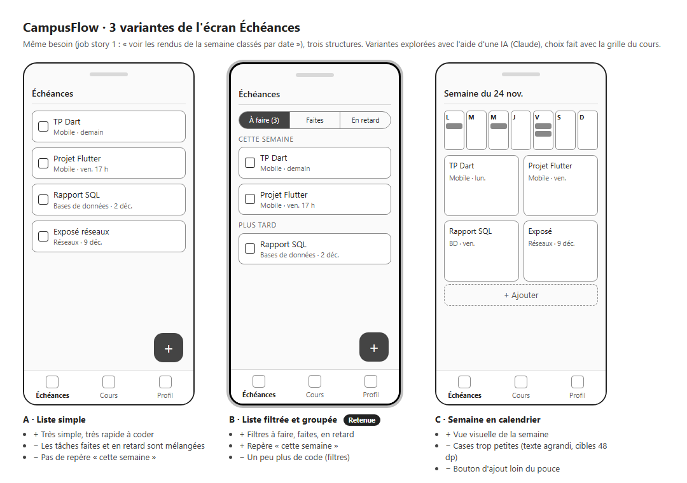

# Séance 2 · Wireframes et choix de variante

## Les 5 écrans (basse fidélité)

| # | Écran | Rôle | Route prévue |
|---|---|---|---|
| 1 | Connexion | Se connecter avec e-mail et mot de passe | `/login` |
| 2 | Échéances | Accueil : tâches triées par date, filtres, bouton « + » | `/taches` |
| 3 | Détail | Une tâche, action principale « Marquer comme fait » | `/taches/:id` |
| 4 | Nouvelle tâche | Formulaire, titre obligatoire, message de confirmation | `/taches/nouvelle` |
| 5 | Cours | Liste des cours et de leurs tâches | `/cours` |

Le Profil (`/profil`) reprend la même structure qu'une carte simple : nom, e-mail, cours suivis et déconnexion.

## Trois variantes de l'écran Échéances

Les variantes ont été explorées avec l'aide d'une IA (Claude), à partir du brief ci-dessous. Le choix a été fait avec la grille du cours.

> **Contexte :** application mobile CampusFlow, suivi des échéances académiques. **Utilisateur :** Ibrahim, étudiant en M1, Android, utilisé à une main. **Tâche :** voir ce qui est dû cette semaine et ajouter une tâche en moins de 3 appuis. **Contraintes :** 360 × 800 dp, Material 3, cibles de 48 dp, contraste AA. **Format :** 3 variantes de l'écran « Échéances », wireframes basse fidélité. **Style :** sobre, un seul accent.

## Grille de décision

Notes de 1 (faible) à 3 (bon).

| Critère | A · Liste simple | B · Liste filtrée et groupée | C · Semaine en calendrier |
|---|---|---|---|
| **Besoin** : voir ce qui est dû cette semaine | 1 · pas de repère de semaine | **3** · section « Cette semaine » et filtre « En retard » | 3 · vue de la semaine très visuelle |
| **Parcours** : nombre d'appuis pour ajouter | **3** · 1 appui sur « + » | **3** · 1 appui sur « + » | 2 · bouton d'ajout en haut, loin du pouce |
| **Accessibilité** : cibles 48 dp, texte à 200 % | **3** · lignes larges | **3** · lignes larges, filtres de 48 dp | 1 · cases de jour trop petites |
| **Faisabilité** en Flutter | **3** · `ListView.builder` | 2 · `ListView.builder` + `SegmentedButton` | 1 · grille de calendrier personnalisée |
| **Total** | 10 | **11** | 7 |

## Décision

Nous retenons la **variante B**. Elle répond le mieux à la job story 1 (voir ce qui est dû cette semaine), garde l'ajout en un appui avec le bouton flottant, et reste accessible car chaque ligne est une grande cible. Elle demande un peu plus de code que la variante A, mais les filtres « À faire », « Faites » et « En retard » sont justement prévus dans le projet (fournisseur dérivé de la séance 6). La variante C est écartée : ses cases de jour deviennent illisibles quand on agrandit le texte, et le bouton d'ajout est loin du pouce.

L'IA a proposé les variantes ; la décision a été prise avec la grille.
