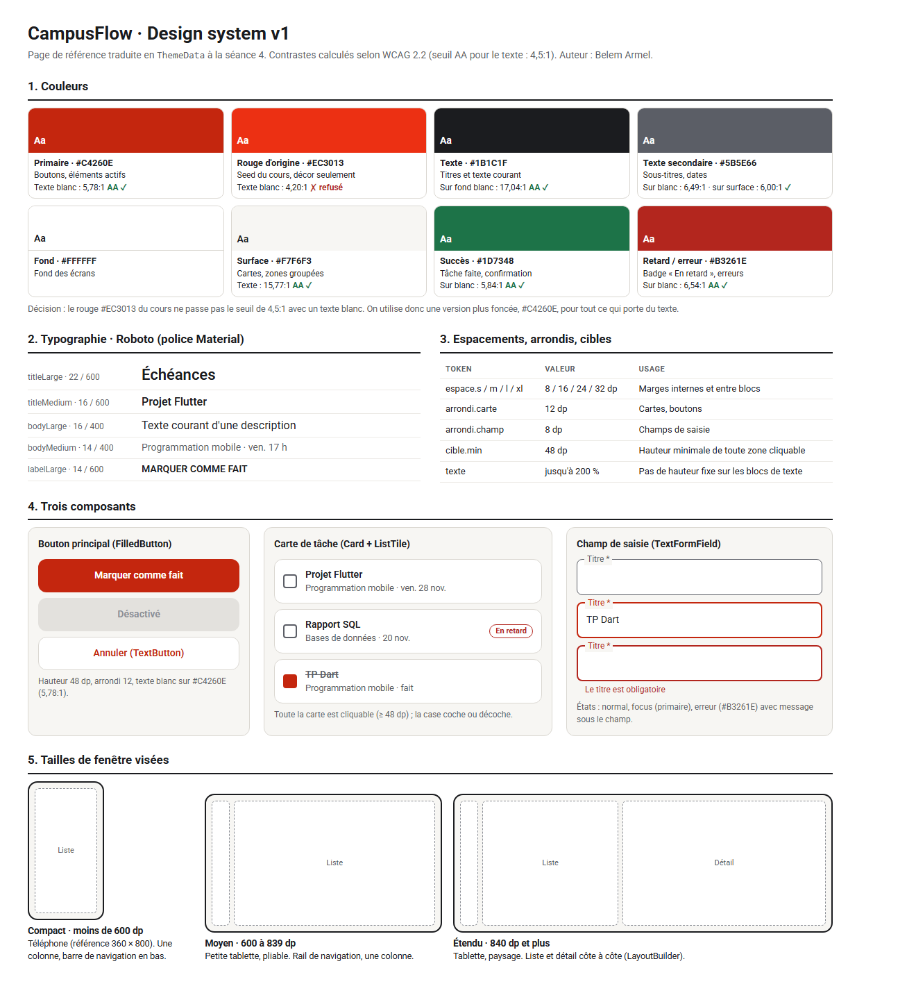

# Séance 2 · Design system v1



## Couleurs et contrastes

Contrastes calculés avec la formule WCAG 2.2. Seuil AA pour le texte courant : **4,5:1**.

| Rôle | Couleur | Utilisée avec | Contraste | Verdict |
|---|---|---|---|---|
| Primaire (boutons, éléments actifs) | `#C4260E` | texte blanc | 5,78:1 | ✓ |
| Rouge d'origine du cours | `#EC3013` | texte blanc | 4,20:1 | ✗ décor seulement |
| Texte | `#1B1C1F` | fond blanc | 17,04:1 | ✓ |
| Texte secondaire | `#5B5E66` | fond blanc / surface | 6,49:1 / 6,00:1 | ✓ |
| Surface (cartes) | `#F7F6F3` | texte `#1B1C1F` | 15,77:1 | ✓ |
| Succès | `#1D7348` | fond blanc | 5,84:1 | ✓ |
| Retard, erreur | `#B3261E` | fond blanc | 6,54:1 | ✓ |

**Décision :** le rouge `#EC3013` vu en cours ne passe pas 4,5:1 avec un texte blanc. Nous utilisons `#C4260E`, plus foncé, pour tout ce qui porte du texte.

## Typographie

Police **Roboto**, la police par défaut de Material sur Android. Échelle : `titleLarge` 22/600, `titleMedium` 16/600, `bodyLarge` 16/400, `bodyMedium` 14/400, `labelLarge` 14/600.

## Espacements, arrondis, cibles

Espaces de 8, 16, 24 et 32 dp. Arrondi de 12 dp pour les cartes et les boutons, 8 dp pour les champs. Toute zone cliquable fait au moins **48 dp**. Aucun bloc de texte n'a de hauteur fixe, pour supporter un texte agrandi à 200 %.

## Trois composants

1. **Bouton principal** (`FilledButton`) : 48 dp de haut, texte blanc sur primaire. `TextButton` pour l'annulation.
2. **Carte de tâche** (`Card` + `ListTile`) : case à cocher, titre, cours et échéance, badge « En retard ».
3. **Champ de saisie** (`TextFormField`) : bordure, libellé, états focus et erreur avec message sous le champ.

## Tailles de fenêtre visées

| Classe | Largeur | Structure |
|---|---|---|
| Compact | moins de 600 dp | Une colonne, barre de navigation en bas |
| Moyen | 600 à 839 dp | Rail de navigation, une colonne |
| Étendu | 840 dp et plus | Liste et détail côte à côte |

## Traduction prévue dans Flutter (séance 4)

```dart
ThemeData(
  colorScheme: ColorScheme.fromSeed(seedColor: Color(0xFFC4260E))
      .copyWith(primary: Color(0xFFC4260E), onPrimary: Colors.white, error: Color(0xFFB3261E)),
  cardTheme: CardThemeData(shape: RoundedRectangleBorder(borderRadius: BorderRadius.circular(12))),
)
```
